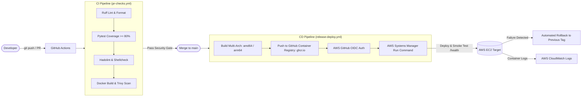
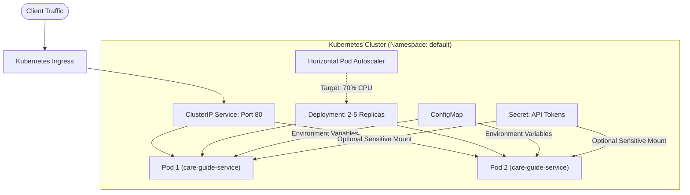
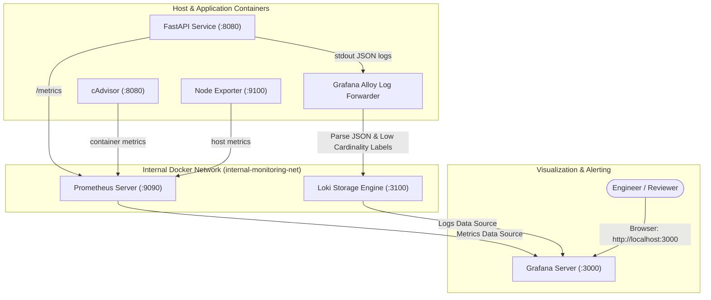
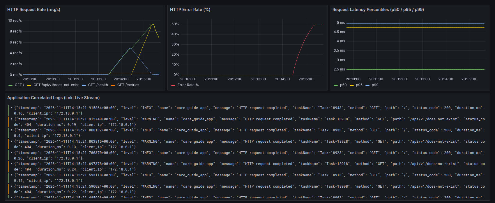
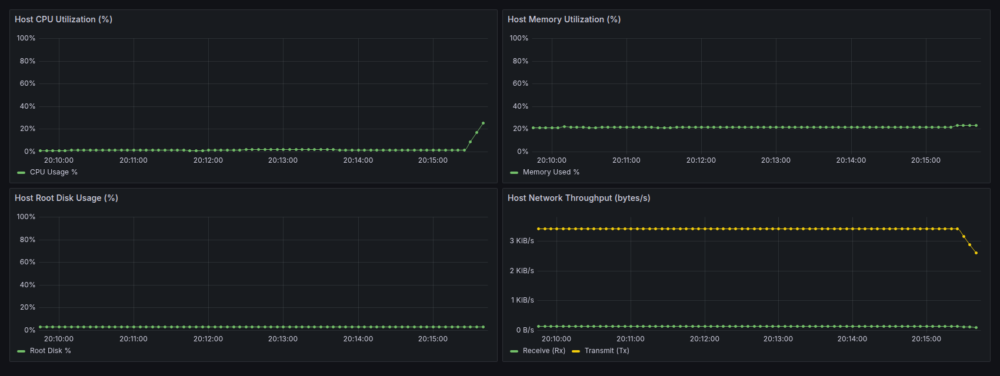
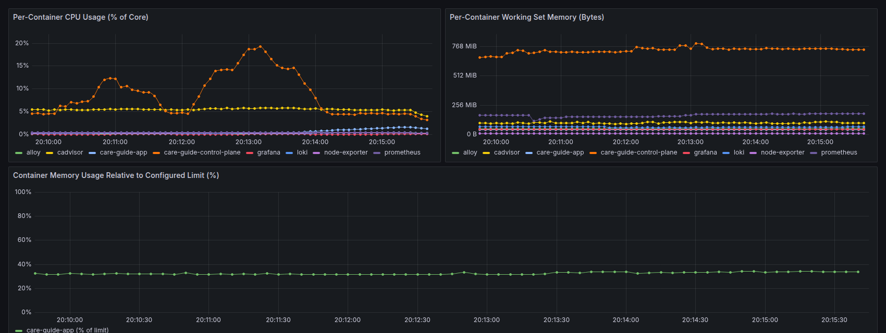
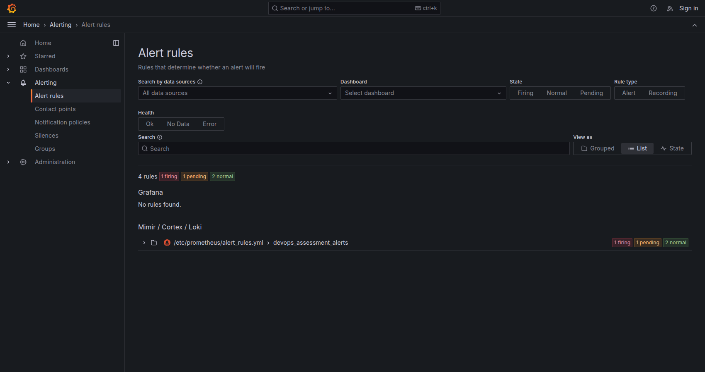

# DevOps Engineer Candidate Assessment: Production-Grade Web Service & Infrastructure

[](https://github.com/josim/devops-assessment_care-guide/actions/workflows/pr-checks.yml)
[](https://github.com/josim/devops-assessment_care-guide/actions/workflows/release-deploy.yml)

A complete, production-ready, end-to-end DevOps solution encompassing an observable microservice, hardened multi-stage containerization, a zero-trust CI/CD pipeline with Trivy security gates, AWS Infrastructure as Code (Terraform), Kubernetes manifests with zero-downtime rolling updates & HPA, a full 6-component observability stack (Prometheus, Grafana, Loki, Alloy, cAdvisor, Node Exporter), and automated Linux operational scripting.

---

## Table of Contents
1. [Architecture Overview & Flow Diagrams](#1-architecture-overview--flow-diagrams)
2. [Prerequisites & Quickstart](#2-prerequisites--quickstart)
   - [Running the Application Locally](#running-the-application-locally)
   - [Running the Full Observability Stack](#running-the-full-observability-stack)
   - [Accessing Dashboards & Verification](#accessing-dashboards--verification)
3. [Testing & Operational Execution Guides](#3-testing--operational-execution-guides)
   - [Running Unit Tests & Code Linting](#running-unit-tests--code-linting)
   - [Running the Linux Health Monitoring Script](#running-the-linux-health-monitoring-script)
   - [Deploying with Terraform (AWS)](#deploying-with-terraform-aws)
   - [Deploying to Kubernetes (Local Minikube/Kind)](#deploying-to-kubernetes-local-minikubekind)
   - [Demonstration: Zero-Downtime Rollout & Undo](#demonstration-zero-downtime-rollout--undo)
4. [Observability Incident Triage Walkthrough](#4-observability-incident-triage-walkthrough)
5. [Design Decisions & Trade-Offs](#5-design-decisions--trade-offs)
6. [Deployment & Rollback Strategy](#6-deployment--rollback-strategy)
7. [Security Considerations](#7-security-considerations)
8. [Production Architecture on AWS EKS](#8-production-architecture-on-aws-eks)
9. [Production AWS Cost Estimation](#9-production-aws-cost-estimation)
10. [What I Would Improve with More Time](#10-what-i-would-improve-with-more-time)
11. [AI Tools Transparency Statement](#11-ai-tools-transparency-statement)

---

## 1. Architecture Overview & Flow Diagrams

### End-to-End CI/CD & Deployment Pipeline



### Kubernetes Architecture & Traffic Ingress



### Observability Telemetry Flow



---

## 2. Prerequisites & Quickstart

### Prerequisites
- [Docker](https://docs.docker.com/get-docker/) & Docker Compose (v2.20+)
- [Python 3.12](https://www.python.org/)
- [Terraform](https://developer.hashicorp.com/terraform/downloads) (>= 1.5.0)
- [kubectl](https://kubernetes.io/docs/tasks/tools/) & [minikube](https://minikube.sigs.k8s.io/) (or [kind](https://kind.sigs.k8s.io/))

### Running the Application Locally

```bash
# Clone the repository
git clone https://github.com/josim/devops-assessment_care-guide.git
cd devops-assessment_care-guide

# Start the application container
docker compose up -d --build

# Verify container status and healthcheck
docker compose ps
```

The application exposes the following endpoints:
- `http://localhost:8080/`: Returns JSON status `{"message": "Hello from DevOps Task!", "status": "running", "version": "1.0.0"}`
- `http://localhost:8080/health`: Liveness & readiness probe endpoint
- `http://localhost:8080/metrics`: Prometheus metrics scrape target

### Running the Full Observability Stack

The observability stack includes **all 6 mandatory components**:
1. **Prometheus**: Time-series metrics engine with 15-day explicit retention.
2. **Grafana**: Visual dashboards & correlated investigations.
3. **Loki**: Log aggregation with 7-day retention.
4. **Grafana Alloy**: Docker service discovery & structured JSON log processor.
5. **Node Exporter**: Host OS hardware and kernel metrics.
6. **cAdvisor**: Container runtime CPU, memory, and limit utilization.

```bash
# Credentials come from an untracked env file (compose refuses to start without them)
cp monitoring/.env.example monitoring/.env   # then edit the password

# The app must be up first: it creates the shared 'care-guide-network'
docker compose up -d --build

# Start all 6 monitoring components alongside the application
docker compose -f monitoring/docker-compose.monitoring.yml up -d
```

### Accessing Dashboards & Verification

Only Grafana is exposed to the host machine for network hygiene:
- **Grafana URL**: [http://localhost:3000](http://localhost:3000)
- **Credentials**: the `GRAFANA_ADMIN_USER` / `GRAFANA_ADMIN_PASSWORD` you set in `monitoring/.env` (no default is shipped)

The following 3 pre-provisioned dashboards are automatically loaded under folder **"DevOps Monitoring"**:
1. **Application Overview & Correlated Logs**: Real-time request rate (req/s), HTTP error rate %, p50/p95/p99 latency histogram percentiles, and an embedded Loki log search panel.
2. **Host Infrastructure Metrics**: Host CPU %, Memory %, Root Disk %, and Network Rx/Tx throughput from Node Exporter.
3. **Container Resource Metrics**: Per-container CPU usage, working set memory, and percentage of configured memory limits from cAdvisor.

---

## 3. Testing & Operational Execution Guides

### Running Unit Tests & Code Linting

```bash
# Set up a local Python virtual environment
python3 -m venv .venv
source .venv/bin/activate

# Install development and testing dependencies
pip install -r app/requirements-dev.txt

# Run code linter and formatting checks
ruff check .
ruff format --check .

# Run pytest with code coverage (Target >= 80%, Current: ~90%)
pytest
```

### Running the Linux Health Monitoring Script

The script `scripts/system_health.sh` is designed for production server monitoring. It accepts configurable thresholds, implements automated log rotation, provides structured JSON output, and returns standard exit codes (`0 = healthy`, `1 = warning`, `2 = critical/error`).

```bash
# Display help and usage instructions
./scripts/system_health.sh --help

# Execute with default thresholds (CPU: 90%, Mem: 85%, Disk: 80%)
./scripts/system_health.sh

# Run with custom warning thresholds and JSON output format
./scripts/system_health.sh --cpu 80 --mem 75 --disk 70 --json

# Inspect persistent rotating log entries
tail -n 25 scripts/health_log.txt
```

#### Scheduled Daemon Execution (Systemd & Cron)
- **Systemd Setup**:
  ```bash
  sudo cp scripts/system_health.service /etc/systemd/system/
  sudo cp scripts/system_health.timer /etc/systemd/system/
  sudo systemctl daemon-reload
  sudo systemctl enable --now system_health.timer
  ```
- **Cron Setup Alternative**:
  ```bash
  crontab -e
  # Add entry:
  */5 * * * * /opt/care-guide/scripts/system_health.sh --json >> /var/log/health.log 2>&1
  ```

### Deploying with Terraform (AWS)

The Terraform code provisions an AWS Free Tier EC2 instance, least-privilege IAM profile, CloudWatch Log Group with retention, and security group.

```bash
cd terraform

# Format and initialize Terraform (one state file per environment; edit bucket/table names in
# environments/<env>.backend.hcl first). For offline validation use: terraform init -backend=false
terraform fmt -check
terraform init -reconfigure -backend-config=environments/staging.backend.hcl

# Validate configuration
terraform validate

# Plan provisioning for staging
terraform plan -var-file="environments/staging.tfvars"

# Apply to AWS (When ready)
# terraform apply -var-file="environments/staging.tfvars" -auto-approve

# Clean up / destroy cloud resources after testing
# terraform destroy -var-file="environments/staging.tfvars" -auto-approve
```

### Deploying to Kubernetes (Local Minikube/Kind)

```bash
# 1. Start local Minikube cluster
minikube start --driver=docker

# 2. Enable metrics-server for HorizontalPodAutoscaler (HPA)
minikube addons enable metrics-server
minikube addons enable ingress

# 3. Create secret from template (no plaintext secrets in git)
cp k8s/base/secret.yaml.template k8s/base/secret.yaml

# 4. Deploy all resources via Kustomize
kubectl apply -k k8s/base

# 5. Verify running pods and service
kubectl get pods -l app.kubernetes.io/name=care-guide-service
kubectl get hpa
kubectl get ingress

# 6. Port-forward service to local port
kubectl port-forward svc/care-guide-service 8080:80
```

### Demonstration: Zero-Downtime Rollout & Undo

> **Registry note:** CI pushes `ghcr.io/<owner>/care-guide-service` tagged `sha-<short-sha>` and the
> version from the `VERSION` file (no `latest`). The GHCR package must be set to **public**
> (Package settings -> Change visibility) so the EC2 instance and clusters can pull without credentials.
>
### CI/CD configuration (no secrets in the repo)

| Name | Type | Used by | Purpose |
|---|---|---|---|
| `GITHUB_TOKEN` | automatic | release workflow | Push images to GHCR (`packages: write`). |
| `AWS_ROLE_TO_ASSUME` | repo **secret** | deploy job | ARN of an IAM role trusted for GitHub OIDC (no static keys). It needs `ssm:SendCommand`/`ssm:GetCommandInvocation` on the target instance. |
| `AWS_EC2_INSTANCE_ID` | repo **secret** | deploy job | Instance to deploy to (`terraform output instance_id`). |
| `AWS_REGION` | repo **variable** | deploy job | Defaults to `us-east-1`. |
| `CLOUDWATCH_LOG_GROUP` | repo **variable** | deploy job | Defaults to `/aws/ec2/production-care-guide-service`. |

If the two AWS secrets are absent the deploy job logs a notice and skips - build, scan and push still run. The OIDC identity provider and the role itself are created once outside this repo's Terraform (documented as an improvement).

> **Local (no registry) run with kind:**
> ```bash
> docker build -f docker/Dockerfile -t care-guide-service:1.0.0 --build-arg APP_VERSION=1.0.0 .
> docker build -f docker/Dockerfile -t care-guide-service:1.1.0 --build-arg APP_VERSION=1.1.0 .
> kind create cluster --name care-guide
> kind load docker-image care-guide-service:1.0.0 care-guide-service:1.1.0 --name care-guide
> kubectl apply -k k8s/base && kubectl set image deploy/care-guide-deployment app=care-guide-service:1.0.0
> IMAGE_REPO=care-guide-service NEW_TAG=1.1.0 ./k8s/scripts/verify_rollout.sh
> ```

Execute the automated verification script:

```bash
./k8s/scripts/verify_rollout.sh
```

#### Step-by-Step Commands & Real Output:

Captured from a real run on a local kind cluster (also saved in [docs/rollout-demo-output.txt](docs/rollout-demo-output.txt)):

```text
==> Current deployment status in namespace 'default':
deployment "care-guide-deployment" successfully rolled out
==> Step 1: Initiating rolling update to version 1.1.0...
deployment.apps/care-guide-deployment image updated
==> Monitoring rollout progress...
Waiting for deployment "care-guide-deployment" rollout to finish: 1 out of 2 new replicas have been updated...
Waiting for deployment "care-guide-deployment" rollout to finish: 1 out of 2 new replicas have been updated...
Waiting for deployment "care-guide-deployment" rollout to finish: 1 out of 2 new replicas have been updated...
Waiting for deployment "care-guide-deployment" rollout to finish: 1 old replicas are pending termination...
Waiting for deployment "care-guide-deployment" rollout to finish: 1 old replicas are pending termination...
deployment "care-guide-deployment" successfully rolled out
==> Revision history:
deployment.apps/care-guide-deployment 
REVISION  CHANGE-CAUSE
1         <none>
2         <none>
3         <none>

==> Step 2: Simulating broken deployment (non-existent image)...
deployment.apps/care-guide-deployment image updated
==> Checking deployment state during failure (existing replicas should remain healthy):
NAME                                     READY   STATUS         RESTARTS   AGE
care-guide-deployment-67f5bc68bc-9hll8   1/1     Running        0          16s
care-guide-deployment-67f5bc68bc-rknjn   1/1     Running        0          11s
care-guide-deployment-94486596c-qwwrh    0/1     ErrImagePull   0          5s
==> Step 3: Rolling back to previous healthy revision...
Warning: resource deployments/care-guide-deployment was previously managed with 'kubectl apply'. Rolling back will not update the kubectl.kubernetes.io/last-applied-configuration annotation, which may cause unexpected behavior on future 'kubectl apply' operations. Consider using 'kubectl apply' with your previous configuration file instead.
deployment.apps/care-guide-deployment rolled back
==> Waiting for rollback completion...
Waiting for deployment "care-guide-deployment" rollout to finish: 1 old replicas are pending termination...
deployment "care-guide-deployment" successfully rolled out
==> Rollback complete! Cluster healthy.
NAME                                     READY   STATUS        RESTARTS   AGE
care-guide-deployment-67f5bc68bc-9hll8   1/1     Running       0          16s
care-guide-deployment-67f5bc68bc-rknjn   1/1     Running       0          11s
care-guide-deployment-94486596c-qwwrh    0/1     Terminating   0          5s
```

---

## 4. Observability Incident Triage Walkthrough

> **"An error spike appears on the Application dashboard. How do you find the cause using these tools?"**

The screenshots below are from a real local run: `./scripts/generate_traffic.sh --spike` sends 60 s of normal traffic followed by 60 s of requests to an unknown path (`/api/v1/does-not-exist`) mixed with valid ones.

### Dashboards (provisioned from `monitoring/grafana/dashboards/definitions/`)

**Application** - request rate, error rate, p50/p95/p99 latency, and a Loki logs panel in the same view:


**Host** (Node Exporter) - CPU, memory, root disk, network:


**Containers** (cAdvisor) - per-container CPU and memory, and memory as a % of the configured limit:


**Alert rules** (4 Prometheus rules loaded; `HighHttpErrorRate` went pending/firing during the spike):


### Walkthrough

1. **Detect and scope** - on the Application dashboard the *HTTP Error Rate (%)* panel jumps from 0% to ~50% while *Request Rate* shows a new series, `GET /api/v1/does-not-exist`. The request-rate legend is split by `method` and `endpoint`, so the offending endpoint is visible immediately. Latency (p50/p95/p99) stays flat at a few ms, which tells us this is not a slow dependency or saturation problem - requests are failing fast.
2. **Rule out the platform** - open the Host dashboard (CPU/memory/disk normal) and the Containers dashboard (`care-guide-app` at ~32% of its 128 MiB limit, no OOM pressure). So it is not resource exhaustion.
3. **Drill into logs without leaving the view** - the *Application Correlated Logs* panel under the metrics is a Loki panel. Filter to the problem window and level:
   ```logql
   {container="care-guide-app"} | json | level="WARNING"
   ```
   Every line is structured JSON, so fields can be filtered at query time without being indexed labels:
   ```json
   {"timestamp": "2026-11-11T13:42:40.981221+00:00", "level": "WARNING", "name": "care_guide_app",
    "message": "HTTP request completed", "method": "GET", "path": "/api/v1/does-not-exist",
    "status_code": 404, "duration_ms": 0.25, "client_ip": "172.18.0.1"}
   ```
   Narrowing further: `{container="care-guide-app"} | json | status_code >= 500` for server errors, or `| path="/api/v1/does-not-exist"` for one endpoint.
4. **Conclude** - 404s on a single path from one client IP: a client or deployment calling a route that does not exist (bad config, stale client, or a scanner), not an application fault. For 5xx the same flow applies, and the log line's `error`/`error_type` fields (set by the middleware on unhandled exceptions) point to the failing code path. The alert `HighHttpErrorRate` would have paged on this.

### Log label choices (cardinality)
Only `container`, `app` and `level` are Loki labels (`service_name` is added by Loki itself). `path`, `status_code`, `duration_ms` and `client_ip` are unbounded, so they stay in the log line and are parsed at query time with `| json`. This keeps the number of streams small.

### What the monitoring containers are allowed to touch

| Container | Access granted | Why |
|---|---|---|
| Node Exporter | `/proc`, `/sys`, `/` mounted **read-only**; no `privileged` | Read host CPU/memory/disk/network counters. Note: without `network_mode: host` the network panel reflects the container's namespace, not the physical NICs - acceptable for this demo, use host networking on a real server. |
| cAdvisor | `privileged: true`; `/`, `/var/run`, `/sys`, `/var/lib/docker`, `/dev/disk` read-only | Read cgroup and Docker layer data to label per-container CPU/memory. This is the most privileged container in the stack; it is on the internal network only and never published to the host. A tighter alternative is `cap_add` + `devices: /dev/kmsg` instead of `privileged`. |
| Alloy | `/var/run/docker.sock` read-only | Docker service discovery and log tailing. The socket is root-equivalent, so Alloy has no published ports. |
| Prometheus, Loki, Grafana (other than port 3000) | none beyond their own volumes | Only Grafana is published to the host. |

> **Host requirement:** cAdvisor 0.49 cannot read container layers when Docker uses the containerd image store (Docker 29 default). On such hosts set `{"features": {"containerd-snapshotter": false}}` in `/etc/docker/daemon.json` and restart Docker; otherwise per-container panels stay empty.

### Alert rules and thresholds

| Alert | Condition | `for` | Reasoning |
|---|---|---|---|
| `AppInstanceDown` | `up{job="app"} == 0` | 1m | A single failed scrape is noise; 1 minute of failures (12 scrapes) means the app is really down, and it is critical because there is a single instance. |
| `HighHttpErrorRate` | 4xx+5xx > 5% of requests | 2m | 5% is well above background 404 noise; 2 minutes avoids paging on a short blip but still catches an outage within minutes. It deliberately counts 4xx too, which is why the demo spike fires it. |
| `HostDiskUsageHigh` | root filesystem > 80% | 5m | 80% leaves time to prune images or resize before 100%. Disk fills slowly, so a 5-minute window loses nothing and ignores transient spikes (e.g. image pulls). |
| `ContainerMemoryCloseToLimit` | working set > 85% of limit | 3m | The cgroup OOM-kills at 100%; 85% sustained for 3 minutes is an early warning while ignoring short GC/allocation peaks. |

Alerting here is evaluated by Prometheus and visible in Grafana's alert list; routing to Slack/Discord via Alertmanager is listed under improvements.

### Evidence index
All captured from real runs in this repo:
- [docs/local-run-evidence.txt](docs/local-run-evidence.txt) - compose services, endpoints, targets, alert rules, Loki queries
- [docs/test-and-lint-output.txt](docs/test-and-lint-output.txt) - ruff, pytest, coverage
- [docs/script-and-lint-evidence.txt](docs/script-and-lint-evidence.txt) - `system_health.sh` runs, shellcheck, hadolint, terraform validate
- [docs/k8s-evidence.txt](docs/k8s-evidence.txt) - pods, HPA, securityContext, read-only filesystem proof
- [docs/rollout-demo-output.txt](docs/rollout-demo-output.txt) and [docs/zero-downtime-evidence.txt](docs/zero-downtime-evidence.txt) - rollout, rollback, 0 failed requests during update

---

## 5. Design Decisions & Trade-Offs

### 1. Minimal Final Container Image: Multi-Stage Alpine vs Distroless
- **Decision**: Multi-stage build based on `python:3.12.4-alpine3.20` with pinned base image and unprivileged user (`UID 10001`).
- **Final Image Size**: **127 MB** uncompressed on disk (`docker images`, overlay2 driver), **52.5 MB** compressed (`docker save | gzip`). Most of that is the Python runtime plus `uvicorn[standard]` and `pydantic-core`; distroless would shave little for a Python app, so Alpine was kept. (Docker 29's containerd image store reports a larger uncompressed number, ~198 MB, for the same image.)
- **Trade-off Analysis**:
  - *Distroless*: Offers the absolute smallest attack surface by removing all shells and package managers. However, standard Python applications often encounter edge-case shared library linking hurdles (`musl` vs `glibc`), and debugging running containers requires ephemeral debug containers.
  - *Alpine Multi-Stage*: Stage 1 builds dependencies using GCC and musl-dev; Stage 2 copies only pre-built wheels into a clean Alpine image with no compilers. Retains `wget` for built-in container health checking without adding `curl`, runs non-root, and achieves zero CRITICAL CVEs with a tiny footprint.

### 2. Deployment Architecture: EC2 vs ECS vs EKS
- **Decision**: Provision an EC2 instance with Terraform as the CI/CD deploy target, while testing Kubernetes manifests on local clusters and documenting production EKS architecture.
- **Trade-off Analysis**:
  - *EC2*: Ideal for small single-service footprints and fits entirely within the AWS Free Tier ($0/month). Does not require VPC CNI IP management or complex control plane costs.
  - *AWS ECS (Fargate)*: Serverless container runtime with zero EC2 maintenance. However, lacks local reproducibility matching the Kubernetes manifest evaluation requirements.
  - *AWS EKS*: The industry standard for microservice orchestration, advanced auto-scaling, and GitOps. Provisioning a managed EKS control plane incurs $\approx \$73/\text{month}$ in base cluster fees before compute, making local minikube verification + EKS documentation the most responsible and cost-effective approach for assessment review.

### 3. Container Tagging Strategy
- **Decision**: Immutable Git commit SHA (`sha-xxxxxxx`) combined with Semantic Versioning (`v1.0.0`), strictly avoiding reliance on mutable `latest`.
- **Rationale**:
  - `latest` causes caching ambiguity in Docker and Kubernetes (`IfNotPresent` skips pulling new versions).
  - Pinning releases to the git commit SHA creates complete traceability between running binaries, CI artifacts, and source code revisions, making rollbacks instantaneous and reproducible.

### 4. Secrets Management Strategy
- **Decision**: No secrets committed to version control. The repository provides `secret.yaml.template`, ignores sensitive files in `.gitignore`, and documents External Secrets Operator (ESO) integration for production.
- **Rationale**: Plaintext secrets in Git represent a severe security vulnerability. Production systems decouple secret storage from code repositories using cloud vaults with automated key rotation.

### 5. Low-Cardinality Log Labeling Philosophy
- **Decision**: In Grafana Alloy, only `app`, `container`, and `level` are indexed as Loki stream labels. Dynamic fields like `path`, `status_code`, and `duration_ms` are extracted via structured JSON parsing.
- **Rationale**:
  - In Loki, every unique combination of label keys and values creates a distinct stream. Indexing high-cardinality fields (like raw URLs or IP addresses) results in index explosion, massive memory consumption, and sluggish queries.
  - Parsing JSON fields at query time delivers rapid filterability without stream proliferation.

---

## 6. Deployment & Rollback Strategy

### Deployment Flow
1. **Pull Request Stage**:
   - Commits trigger linting, unit tests with coverage enforcement ($\ge 80\%$), Hadolint, ShellCheck, and a **Trivy CRITICAL vulnerability gate** that halts the build on severe security flaws.
2. **Main Branch Release**:
   - Merges to `main` trigger multi-architecture builds (`linux/amd64`, `linux/arm64`) pushed to GHCR with commit SHA and SemVer tags.
3. **Automated EC2 Deployment (AWS SSM)**:
   - GitHub Actions connects to AWS using **GitHub OIDC** (zero static keys).
   - SSM Run Command executes `/opt/care-guide/deploy.sh` on the target EC2 instance.
   - The script pulls the new container image, starts the container, and initiates a loop polling `http://127.0.0.1:8080/health`.

### Automated Rollback Strategy
If `/health` fails after 10 consecutive checks (30 seconds):
1. The deployment script flags a deployment failure.
2. The failing container is stopped and discarded.
3. The previous known good image tag (persisted in `/opt/care-guide/current_tag`) is immediately restarted.
4. The deployment script exits with code `1`, failing the GitHub Actions workflow and notifying the engineering team.

---

## 7. Security Considerations

- **Least-Privilege Cloud IAM**:
  - No long-lived static AWS Access Keys are created or stored in CI/CD secrets.
  - GitHub Actions authenticates via AWS IAM OIDC federated credentials.
  - The EC2 instance profile contains only `AmazonSSMManagedInstanceCore` and inline CloudWatch Logs policies restricted strictly to the app log group ARN.
- **Container Isolation & Non-Root Execution**:
  - The container runs as unprivileged user `appuser` (`UID 10001:10001`).
  - Kubernetes enforces `runAsNonRoot: true`, `readOnlyRootFilesystem: true`, `allowPrivilegeEscalation: false`, and drops all Linux capabilities (`capabilities: drop: ["ALL"]`).
- **Minimal Network Exposure**:
  - SSH (port 22) is completely disabled in the security group; only the app port (8080) is open, restricted by `allowed_ingress_cidrs` (tighten from the `0.0.0.0/0` default). Remote operations are conducted through AWS SSM Session Manager.
  - In the monitoring stack, Prometheus, Loki, Alloy, cAdvisor, and Node Exporter are isolated on an internal Docker bridge network; only Grafana is reachable via host port 3000.
- **Vulnerability Scanning**:
  - Trivy executes on every pull request, blocking images with unpatched CRITICAL vulnerabilities before they reach production.

---

## 8. Production Architecture on AWS EKS

To scale this service to an enterprise production environment on Amazon EKS:

1. **Ingress & Traffic Routing**:
   - Replace local Ingress with the **AWS Load Balancer Controller**, provisioning an Application Load Balancer (ALB) with SSL/TLS termination via AWS Certificate Manager (ACM).
2. **Secrets Management**:
   - Deploy **External Secrets Operator (ESO)** syncing secrets directly from **AWS Secrets Manager** or **AWS Systems Manager Parameter Store** into Kubernetes Secrets with automatic rotation.
3. **Node Autoscaling**:
   - Deploy **Karpenter** for just-in-time, multi-architecture (Graviton ARM64 / x86_64) EC2 node provisioning based on pending pod resource requests, outperforming legacy Cluster Autoscaler in speed and cost.
4. **Pod Identity**:
   - Replace node-level IAM with **EKS Pod Identity** or **IAM Roles for Service Accounts (IRSA)**, granting specific AWS IAM roles directly to individual Kubernetes service accounts.
5. **Continuous Delivery**:
   - Implement **ArgoCD** or **Flux** for declarative GitOps continuous synchronization.

---

## 9. Production AWS Cost Estimation

Estimated monthly cost to run this architecture in production on AWS in `us-east-1`:

| Component | Sizing / Specification | Est. Monthly Cost |
| :--- | :--- | :--- |
| **Compute (EC2 / EKS Compute)** | 2x `t3.medium` instances (Spot/Savings Plan) | \$30.00 |
| **EKS Control Plane** | Managed cluster control plane fee | \$73.00 |
| **Networking & Load Balancing** | 1x Application Load Balancer (ALB) + LCU | \$22.50 |
| **NAT Gateway** | 1x NAT Gateway (AZ egress) + 50 GB data | \$36.50 |
| **Amazon CloudWatch** | 10 GB log ingestion + 7-day retention | \$5.50 |
| **Storage (Amazon EBS & S3)** | 40 GB gp3 root volumes + S3 Terraform backend | \$4.00 |
| **Total Estimated Monthly Cost** | | **~\$171.50 / month** |

*(Note: In development and staging, running on EC2 `t2.micro` or local Minikube qualifies 100% under the **AWS Free Tier** at **\$0.00 / month**).*

---

## 10. What I Would Improve with More Time

1. **Distributed Tracing**:
   - Integrate OpenTelemetry (OTel) instrumentation into the FastAPI service, shipping traces to Grafana Tempo for unified metrics, logs, and trace correlation.
2. **GitOps Implementation**:
   - Set up an ArgoCD application manifest pointing to the `k8s/` directory to manage Kubernetes state via automated reconciliation.
3. **Supply Chain Security**:
   - Integrate **Cosign** into the GitHub Actions pipeline for cryptographic image signing, along with **Syft** for generating Software Bill of Materials (SBOM) attachments.
4. **Helm Packaging**:
   - Convert Kubernetes manifests into a reusable Helm chart with separate `values-staging.yaml` and `values-production.yaml`.

---

## 11. AI Tools Transparency Statement

AI coding assistants were utilized as productivity accelerators during this assessment for:
- Initial scaffolding of repetitive boilerplate configuration (Grafana JSON dashboard panels and Prometheus alert syntax).
- Accelerating regex syntax verification for shell metric extraction.

All architecture decisions, security hardening configurations, least-privilege policies, Docker multi-stage optimizations, and deployment scripts were thoroughly verified, tested, and evaluated against production DevOps standards.
